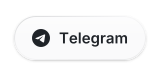
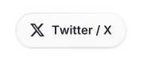

Android platform and full-stack developer. I work from the Linux kernel and AOSP up through iOS and Android apps in Flutter, Node.js backends and React and Next.js frontends, mainly in Java, Kotlin, C, TypeScript and Python. I also build command-line tools in Go and Rust.

### Projects

| Project | What it does | Built with |
| --- | --- | --- |
| [Penguin Dialer](https://github.com/Project-PenguinOS/penguin_packages_apps_Dialer) | Android dialer with a floating Liquid Glass tab bar and app and caller details on VoIP calls | Java |
| [Penguin Keyboard](https://github.com/Project-PenguinOS/penguin_packages_inputmethods_LatinIME) | LatinIME keyboard with an iOS Liquid Glass theme | Java |
| [tg-bridge](https://github.com/jendermine/tg-bridge) | Sends prompts and images from Telegram to live coding-agent sessions on Linux | Python |
| [penguindex-go](https://github.com/jendermine/penguindex-go) | Uploads and manages Google Drive files from the command line | Go |
| [rust-encrypt-util](https://github.com/jendermine/rust-encrypt-util) | Encrypts credentials with PBKDF2 and AES-256-GCM | Rust |
| [vaultanchor](https://github.com/jendermine/vaultanchor) | Counter dApp on Solana with a React frontend | Rust, Anchor |

Contributed to [KDE Connect for Android](https://invent.kde.org/network/kdeconnect-android/-/merge_requests/789), [clipman](https://github.com/MohammedEl-sayedAhmed/clipman) and [NoteNext](https://github.com/NoteNext/NoteNext).

### Stack

| Layer | Tools |
| --- | --- |
| Languages | TypeScript, JavaScript, Java, Kotlin, C, C++, Python, Rust, Go, Dart, Shell |
| Mobile | Flutter, Jetpack Compose |
| Android platform | AOSP, Linux kernel |
| Web | Next.js, React, Svelte, Tailwind CSS, Three.js |
| Backend | Node.js, Express, FastAPI, Prisma |
| Data | PostgreSQL, Supabase, Redis, MongoDB |
| Infrastructure | AWS, DigitalOcean, Cloudflare, Vercel, Docker, Linux |

### Activity

 

See the pull requests I have [created](https://github.com/pulls?q=is%3Apr+author%3Ajendermine+-user%3Ajendermine), [merged](https://github.com/pulls?q=is%3Apr+author%3Ajendermine+is%3Amerged+) and [reviewed](https://github.com/pulls?q=is%3Apr+reviewed-by%3Ajendermine+-user%3Ajendermine).

### Connect

<a href="https://github.com/jendermine"><picture><source media="(prefers-color-scheme: dark)" srcset="assets/btn-github-dark.svg"></picture></a><a href="https://www.linkedin.com/in/rohit-ghosh-b4013724b/"><picture><source media="(prefers-color-scheme: dark)" srcset="assets/btn-linkedin-dark.svg"></picture></a><a href="https://t.me/jendermine"><picture><source media="(prefers-color-scheme: dark)" srcset="assets/btn-telegram-dark.svg"></picture></a><a href="https://x.com/jendermean"><picture><source media="(prefers-color-scheme: dark)" srcset="assets/btn-x-dark.svg"></picture></a><a href="mailto:jendermine@gmail.com"><picture><source media="(prefers-color-scheme: dark)" srcset="assets/btn-email-dark.svg"></picture></a>

